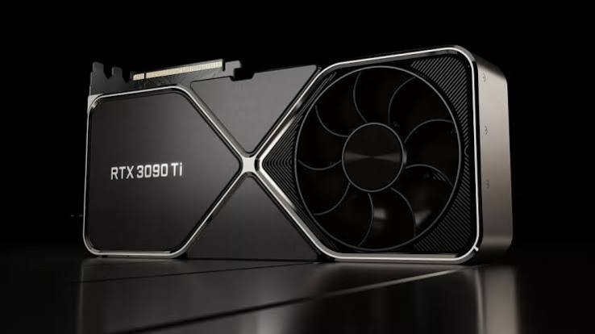
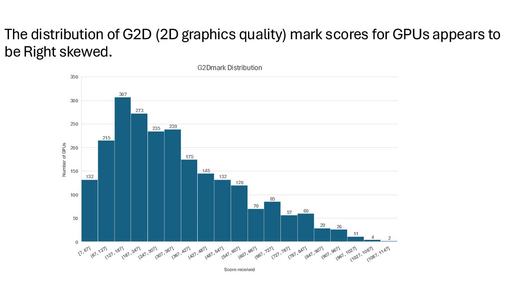
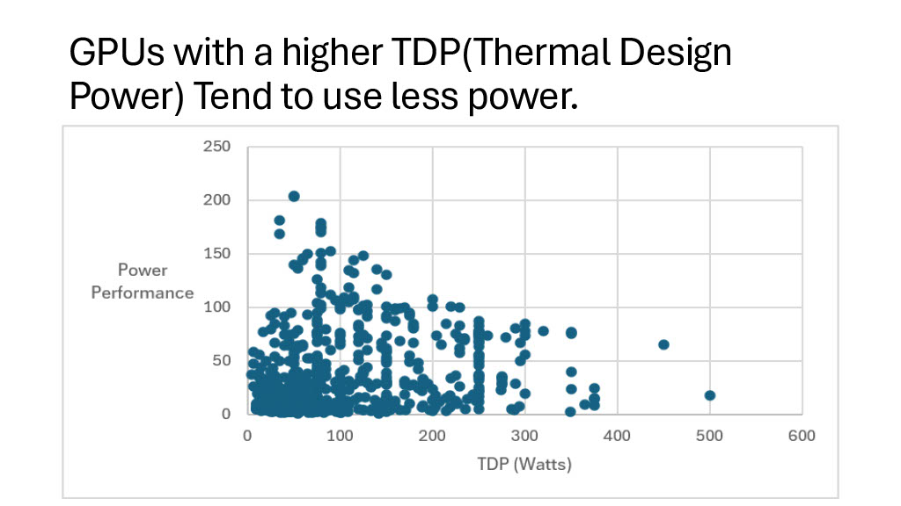
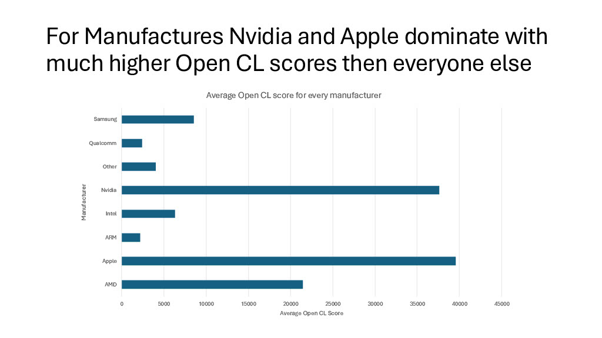
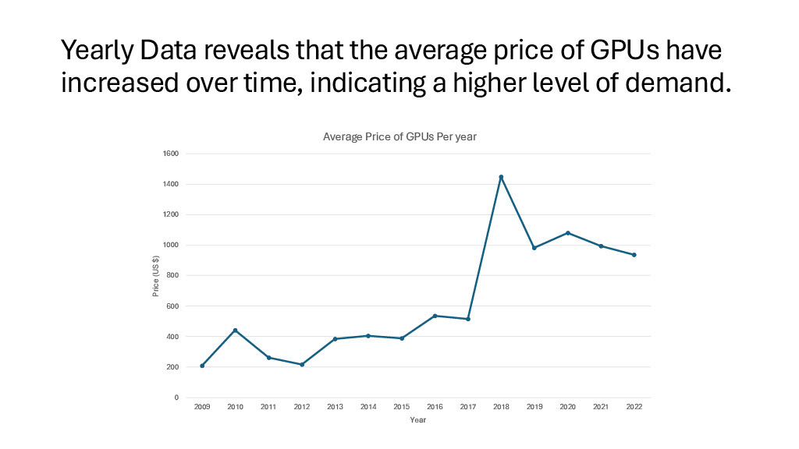

What is the distribution of 2D graphics among GPUs? The distribution was determined by analyzing the frequincy of G2Dmark scores. After cleaning the data by changing the length of each of the columns to be 60 Units, the table ended up counting, and showing that most GPUs ended up having a smaller G2D mark thus leading to a Right skewed graph.

What is the relationship between TDP (Thermal Design Power) and Power Performance? To construct the scatter plot we plotted each GPU using its TDP measurement and its Power Performance score. We reformatted the Axis Titles to have better readability by making them all horizontal.

Which GPU manufacturer has the highest average performance? To create this bar chart, we used OpenCl scores of GPUs from Samsung, Qualcomm, Nvidia, Intel, ARM, Apple, AMD, and other manufacturers. We created a pivot table and moved all the manufacturers to the Values section to make the chart easier to visualize. The pivot table automatically created the average score for each manufacturer. There is a clear skew between manufacturers, with Nvidia and Apple having the highest average scores, indicating better general performance.

How has the average launch price of consumer GPU’s changed overtime?  In order to create this time-series graph, we used the testing date of different GPUs from 2009 to 2022 and the individual prices of those GPUs. I then created a pivot table and averaged the prices and made the x axis year and the y axis average price. I then added titles to better represent both axis, and finally after doing this the graph ended up showing a clear upward pattern showing a general increase in the price of GPUs over the years.
